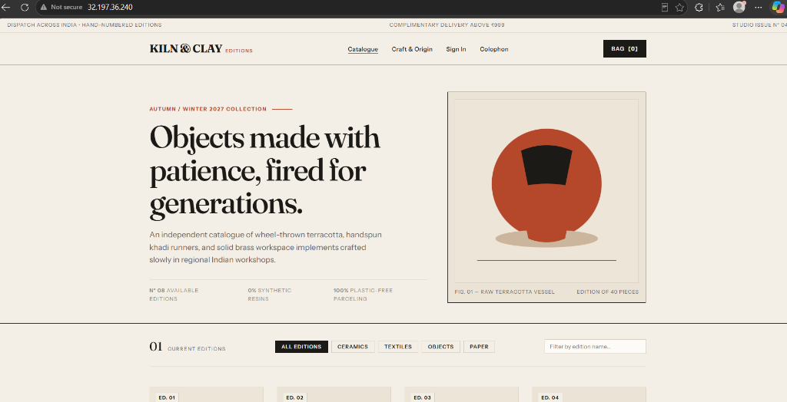
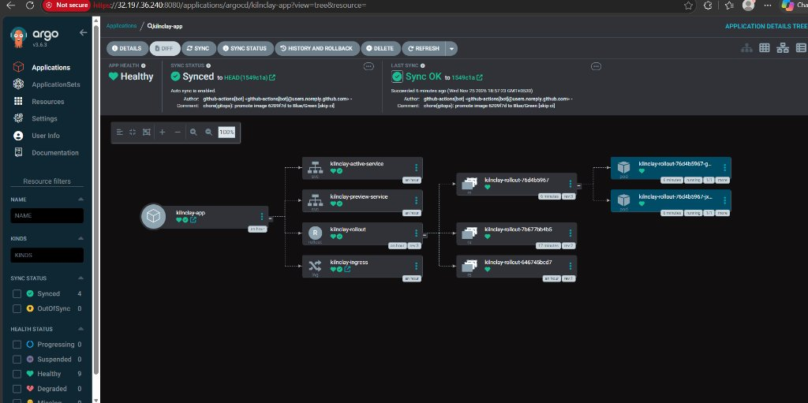
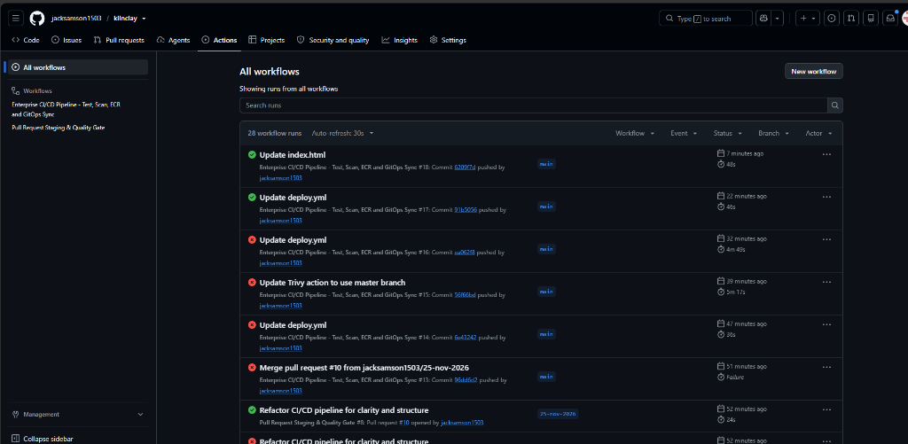
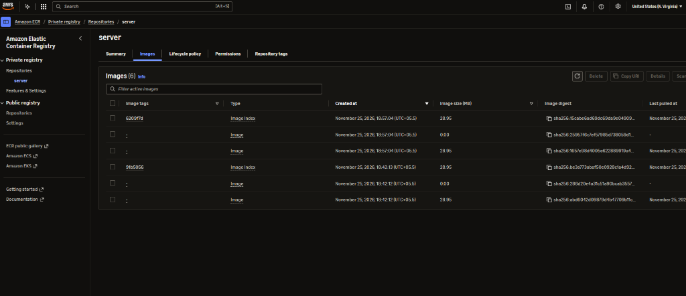
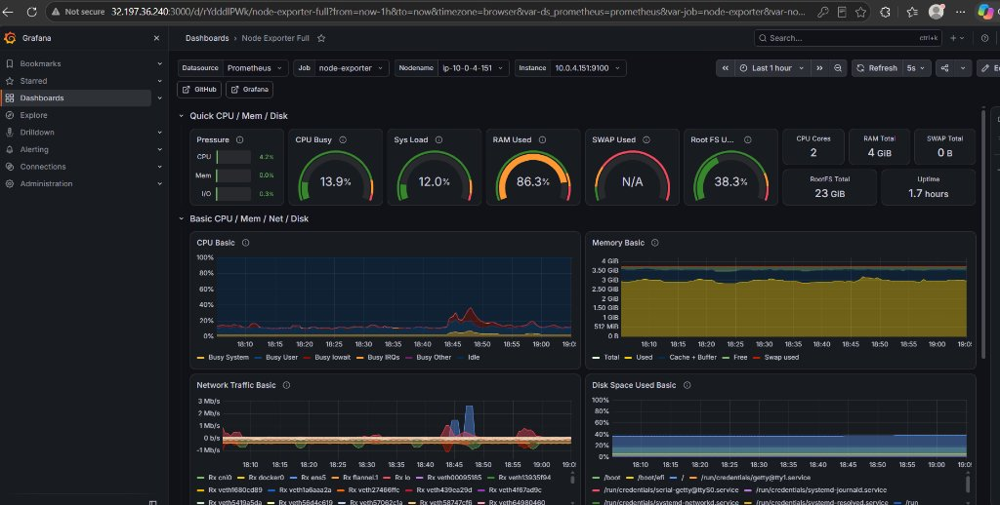
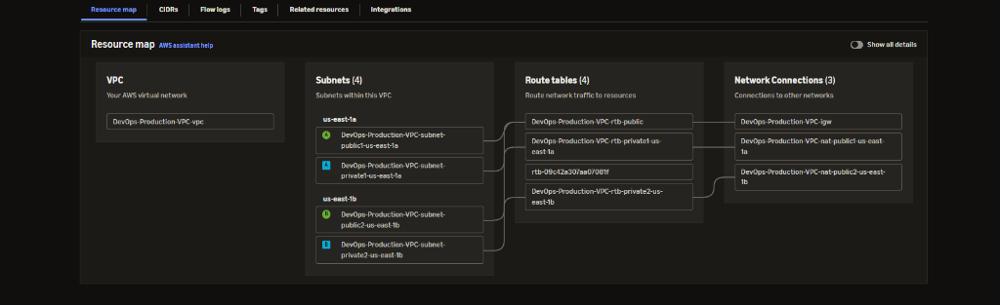
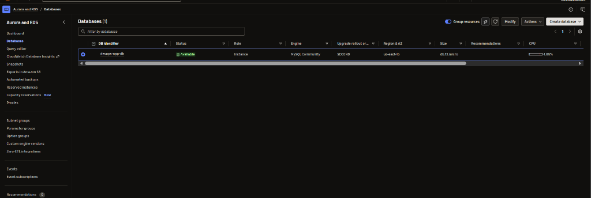
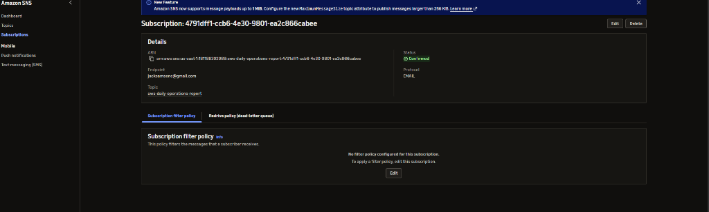

# Kiln & Clay — Enterprise Cloud-Native GitOps & DevSecOps Platform on AWS

[](https://aws.amazon.com/)
[](https://kubernetes.io/)
[](https://argo-cd.readthedocs.io/)
[](https://argoproj.github.io/rollouts/)
[](https://github.com/features/actions)
[](https://trivy.dev/)
[](https://ai.google.dev/)
[](https://grafana.com/)

An end-to-end, enterprise-grade cloud-native e-commerce platform and DevSecOps ecosystem. Built on a multi-tier custom AWS Virtual Private Cloud (VPC), utilizing lightweight Kubernetes with Argo CD and Argo Rollouts for automated Blue/Green deployments, backed by private Amazon RDS (MySQL), monitored with Prometheus and Grafana, and powered by AI-augmented failure diagnostics.

---

## Architecture Overview

```
                                [ DEVELOPER ]
                                      │
                                      ▼
                        [ GitHub Repository (main) ]
                                      │
                 ┌────────────────────┴────────────────────┐
                 ▼                                         ▼
      [ PR Quality Gate ]                     [ Main CI/CD Pipeline ]
      • Linting & Syntax Tests                • 1. Code Integrity Tests
      • Docker Build Validation               • 2. Build Docker Container
      • Gemini AI Error Diagnostics           • 3. Trivy Security Scan (Block Critical)
                                              • 4. Push Image to Amazon ECR
                                              • 5. GitOps Auto-Promote (rollout.yaml)
                                              • 6. Gemini AI Failure Analysis
                                              • 7. AWS SNS Real-Time Notifications
                                                           │
                                                           ▼
                                                [ Amazon ECR (Private) ]
                                                           │
┌──────────────────────────────────────────────────────────┼──────────────────────────────────────────────────────────┐
│ AWS Custom VPC (10.0.0.0/16)                             ▼                                                          │
│                                              [ Argo CD Controller ]                                                 │
│                                                          │                                                          │
│                                                (Syncs Git Manifest)                                                 │
│                                                          ▼                                                          │
│                                            [ Argo Rollouts Controller ]                                             │
│                                                          │                                                          │
│   PUBLIC SUBNETS (10.0.1.0/24, 10.0.2.0/24)             ▼                                                          │
│   • Internet Gateway                                                                                                │
│   • Traefik Ingress (Port 80) ──────────────► [ Active Service (Port 30080) ] ────► [ Active Pods (Blue rev:3) ]    │
│   • NAT Gateways (Outbound Internet)          [ Preview Service (Port 30081) ] ───► [ Staging Pods (Green rev:2) ] │
│                                                                                            │                        │
│   PRIVATE DATABASE SUBNETS (10.0.3.0/24, 10.0.4.0/24)                                      ▼                        │
│   • Amazon RDS MySQL Database (Isolated, 0% Public Access) ◄───────────────────────────────┘                        │
└─────────────────────────────────────────────────────────────────────────────────────────────────────────────────────┘
                                                           │
                                                           ▼
                                         [ Observability Stack (Port 3000) ]
                                         • Prometheus Metric Scraper
                                         • Grafana Live Dashboards (Node Exporter)
```

---

## 1. Live Production Storefront

The production application is an editorial e-commerce platform served through Nginx containers on Kubernetes with custom ingress routing.



* **Cluster Endpoint:** `http://32.197.36.240:30080` (or Port 80 via Traefik Ingress)
* **Features:** Responsive catalog, dynamic cart calculations, real-time checkout, and persistent storage.

---

## 2. GitOps Continuous Delivery & Zero-Downtime Blue/Green Deployments

Argo CD maintains continuous synchronization between the `main` branch of this repository and the live Kubernetes cluster. Argo Rollouts manages progressive Blue/Green delivery.



### Blue/Green Mechanics
1. **Zero Downtime Deployments:** When a new container image is pushed to ECR, the pipeline updates `k8s/rollout.yaml`. Argo CD detects the change and creates a new ReplicaSet (`rev:3`).
2. **Automated Traffic Switching:** New pods are spun up on the `kilnclay-preview-service` (Port 30081). Once all health probes succeed, traffic switches instantly to `kilnclay-active-service` (Port 30080).
3. **Graceful Connection Draining (`scaleDownDelaySeconds: 30`):** The previous revision (`rev:2`) remains alive for 30 seconds to allow active customer checkout sessions to complete without interruption.
4. **Instant 1-Click Rollback:** Old revisions (`rev:1`, `rev:2`) are maintained with 0 pods as persistent markers, enabling instant rollbacks if unexpected production issues occur.

---

## 3. Enterprise CI/CD Pipeline with DevSecOps & AI Diagnostics

The automated GitHub Actions workflow enforces quality gates, security compliance, immutable tagging, and AI-powered failure resolution.



### Key Pipeline Stages
* **Stage 1 — Code Integrity & Syntax Check:** Validates semantic structure of HTML5 pages, executes ES6 module syntax checks with Node.js 20.
* **Stage 2 — Container Build & Trivy Security Scan:**
  * Builds the container using Buildx and layer caching.
  * Scans the image with **Aquasec Trivy** for CVEs and OS library vulnerabilities.
  * Blocks deployments immediately (`exit-code: 1`) if critical vulnerabilities are discovered.
  * Pushes verified images tagged with immutable Git Commit SHAs (`${{ github.sha::7 }}`) to Amazon ECR.
* **Stage 3 — GitOps Auto-Promote:** Automatically updates `image:` inside `k8s/rollout.yaml`, commits as `github-actions[bot]`, and pushes to `main` with `[skip ci]`.
* **Stage 4 — AI Failure Analysis:**
  * If any build step fails, an inline diagnostics step captures real-time runner logs.
  * Redacts AWS keys and sensitive patterns.
  * Sends log context to **Google Gemini API** (`gemini-1.5-flash`).
  * Generates a 3-point diagnostic report (Root Cause, Code Fix, Verification Command) directly in `$GITHUB_STEP_SUMMARY`.
* **Stage 5 — Real-time AWS SNS Notifications:** Publishes structured operational reports (including stage matrices and AI summaries) to AWS SNS topics for email broadcasting.

---

## 4. Amazon ECR Private Container Registry

All container images are scanned, tagged with unique Git commit identifiers, and stored in a private AWS Elastic Container Registry.



* **Repository:** `181188392988.dkr.ecr.us-east-1.amazonaws.com/server`
* **Image Tagging Strategy:** Short Git Commit SHA (e.g. `6209f7d`, `91b5056`) + `latest` pointer.
* **Security:** Authenticated via IAM policies; zero public pull access.

---

## 5. Live Observability & Metric Monitoring (Grafana + Prometheus)

Cluster health, node resource consumption, and container metrics are tracked using Prometheus and visualized through Grafana dashboards.



* **Dashboard URL:** `http://32.197.36.240:3000`
* **Stack:** `kube-prometheus-stack` (Prometheus Operator, Grafana, Node Exporter, Kube-State-Metrics).
* **Metrics Monitored:**
  * Host CPU and memory saturation.
  * Per-pod network traffic and memory limits.
  * Container restart counts and crash detection.

---

## 6. AWS 3-Tier VPC Architecture

The underlying cloud infrastructure was provisioned inside a custom AWS Virtual Private Cloud (`10.0.0.0/16`) spanning multiple Availability Zones for high availability and network isolation.



| Subnet Tier | CIDR Blocks | Availability Zones | Hosted Resources | Access Level |
| :--- | :--- | :--- | :--- | :--- |
| **Public Subnets** | `10.0.1.0/24`, `10.0.2.0/24` | `us-east-1a`, `us-east-1b` | Internet Gateway, Traefik Ingress, NAT Gateways | Public Internet (Inbound & Outbound) |
| **Private App Subnets** | `10.0.3.0/24` | `us-east-1a` | EC2 K3s Kubernetes Cluster, Argo CD, Rollouts | Private (Outbound via NAT Gateway only) |
| **Private DB Subnets** | `10.0.4.0/24` | `us-east-1b` | Amazon RDS MySQL Cluster | 100% Isolated (No Internet Access) |

---

## 7. Amazon RDS (MySQL) Database

Production relational data is hosted on a managed Amazon RDS instance isolated within dedicated database subnets.



* **Instance Identifier:** `devops-app-db`
* **Engine:** MySQL Community 8.0 (`db.t3.micro`)
* **Subnet Group:** `devops-rds-subnet-group`
* **Security Lockdown:** Inbound port `3306` allowed **only** from the Kubernetes security group (`ec2-k8s-sg`). `Publicly Accessible: NO`.

---

## 8. Automated Alerting (Amazon SNS)

Build completions, deployment events, and incident alerts are broadcasted through Amazon Simple Notification Service.



* **Topic ARN:** `arn:aws:sns:us-east-1:181188392988:aws-daily-operations-report`
* **Subscription:** Email notifications confirmed and dispatched automatically upon pipeline execution.

---

## Repository Structure

```text
kilnclay/
├── .github/
│   └── workflows/
│       ├── pr.yml              # Pull Request staging gate with AI failure commenter
│       └── deploy.yml          # Production CI/CD with Trivy, ECR, GitOps sync & SNS
├── assets/
│   ├── images/                 # Storefront artwork & vector assets
│   └── screenshots/            # Architecture evidence & operational screenshots
├── css/                        # Responsive CSS3 styles (variables, components, pages)
├── js/                         # Vanilla ES6+ modules & AWS Cognito authentication
├── k8s/
│   ├── rollout.yaml            # Argo Rollouts Blue/Green deployment specification
│   ├── service.yaml            # Active (30080) and Preview (30081) NodePort services
│   └── ingress.yaml            # Traefik Ingress routing for standard Port 80
├── Dockerfile                  # Production-optimized Nginx Alpine container
├── README.md                   # System documentation & architectural reference
├── index.html                  # Catalog landing page
├── cart.html                   # Shopping cart controller
├── checkout.html               # Payment & dispatch flow
├── login.html                  # Customer authentication interface
└── package.json                # Project descriptor & test definitions
```

---

## Recommended Repository Renaming

To reflect the scope of this project on your GitHub profile and resume, rename the repository under **Settings $\rightarrow$ General $\rightarrow$ Repository name** to one of the following:

* **`enterprise-devops-gitops-ai-platform`** *(Recommended)*
* **`aws-gitops-bluegreen-devsecops`**
* **`cloudnative-ecommerce-devops-platform`**

---

## License & Author

* **Author:** Jack Samson C ([@jacksamson1503](https://github.com/jacksamson1503))
* **License:** MIT
